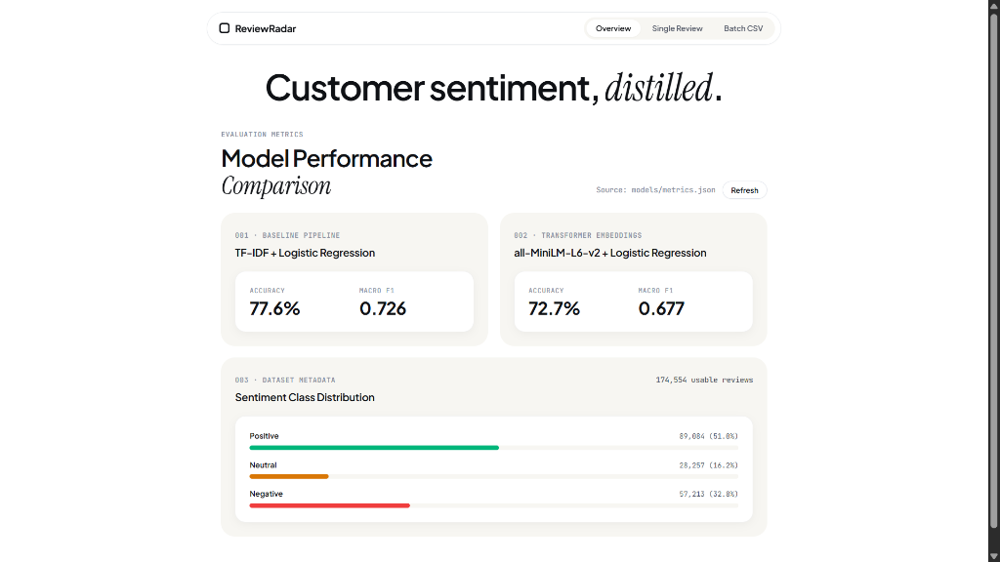
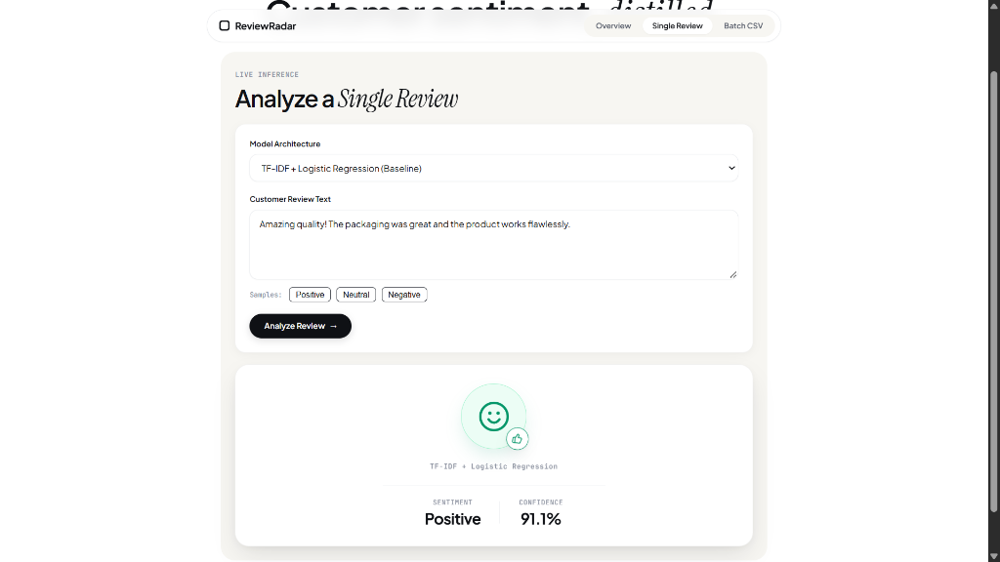
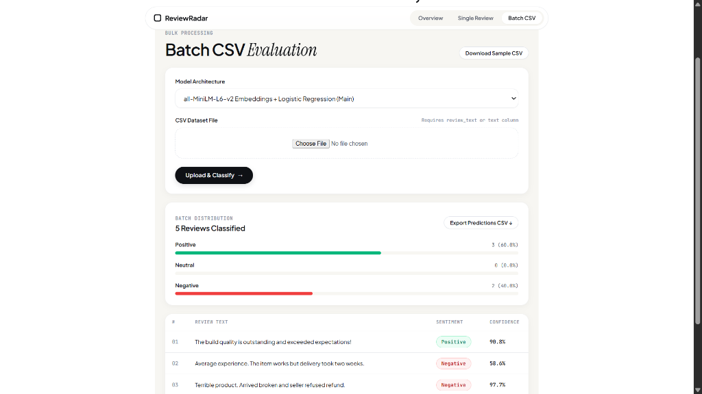

# ReviewRadar

ReviewRadar is an academic AI and Expert Systems project focused on **3-class sentiment classification** (Positive, Neutral, Negative) for consumer reviews across e-commerce and local business services.

The project evaluates and compares two machine learning approaches:
1. A classical **TF-IDF + Logistic Regression** baseline pipeline.
2. A dense semantic representation using frozen **all-MiniLM-L6-v2 sentence embeddings + Logistic Regression**.

The final trained models and empirical metrics are served via a **FastAPI** REST backend and visualized through a **React (Vite)** single-page web application.

---

## Application Screenshots

### 1. Model Performance Dashboard
Displays empirical evaluation metrics directly loaded from `models/metrics.json` along with dataset distribution breakdowns.



### 2. Single Review Analysis
Allows live sentiment inference with instant confidence scoring and emotional visual feedback for Positive, Neutral, and Negative predictions.



### 3. Batch CSV Evaluation
Enables bulk classification of customer review files, showing sentiment distribution percentages and downloadable enriched results.



---

## Problem Statement

Online customer reviews are generated in massive volumes across diverse consumer platforms (such as product marketplaces and hospitality services). Manually reading, categorizing, and monitoring this feedback is labor-intensive, slow, and prone to human subjectivity.

Automating sentiment analysis for consumer feedback presents practical challenges:
- Customer sentiment is not purely binary; neutral reviews (3 stars) frequently express mixed feelings or lukewarm satisfaction that binary classifiers fail to capture.
- Different consumer domains (physical goods on Amazon vs. local services on Yelp) utilize different vocabularies and writing styles.
- Deploying large deep learning models often incurs substantial computational overhead, creating a trade-off between semantic depth, inference speed, and classification accuracy.

This project investigates whether a lightweight transformer embedding model (`all-MiniLM-L6-v2`) used as a frozen feature extractor outperforms a classical sparse lexical baseline (`TF-IDF`), and packages the resulting models into an accessible real-time web application.

---

## Main Features

- **Empirical Metrics Dashboard**: Fetches verified test-set metrics (Accuracy, Macro Precision, Macro Recall, Macro F1, Weighted F1) directly from `models/metrics.json` through the FastAPI backend without hardcoded numbers.
- **Real-Time Single Review Inference**: Evaluates user-submitted review text with either the TF-IDF baseline or the MiniLM embedding model, returning sentiment classification and confidence scores.
- **Batch CSV Processing**: Accepts CSV uploads containing a `review_text` or `text` column, performs batch inference, calculates sentiment distribution ratios, and exports classified results.
- **Automatic Smooth Scrolling**: UI automatically glides down to display prediction results upon completion on both single and batch analysis views.
- **Lightweight CPU Inference**: Utilizes an ONNX Runtime session and tokenizers for `all-MiniLM-L6-v2` dense vector generation, allowing efficient CPU execution without large multi-gigabyte PyTorch installations.
- **Decoupled Architecture**: React frontend communicates strictly via HTTP REST endpoints; no Python model weights or ML runtimes are loaded in the browser.
- **One-Click Launchers**: Batch script (`run_app.bat`) and PowerShell script (`run_app.ps1`) to boot both backend and frontend servers in one step.

---

## Dataset Sources & Usable Records

Training and evaluation were conducted on a combined dataset derived from two publicly accessible benchmark sources:

1. **Amazon Reviews 2023**: Product reviews containing `rating`, `title`, and `text`.
2. **Yelp Open Dataset**: Local business reviews containing `stars` and `text`.

### Usable Data Counts (from `models/metrics.json`)

| Source | Raw Inspected | Usable After Cleaning | Usable Percentage |
|---|---|---|---|
| **Amazon Reviews 2023** | 100,000 | **97,499** | 97.50% |
| **Yelp Open Dataset** | 100,000 | **77,055** | 77.06% |
| **Combined Usable Total** | **200,000** | **174,554** | **87.28%** |

The cleaned dataset of **174,554** records was partitioned into an 80/20 train-test split:
- **Training Set (80%)**: 139,643 reviews
- **Testing Set (20%)**: 34,911 reviews

### Class Distribution (Combined Dataset)

| Sentiment Class | Star Rating Equivalent | Total Count | Percentage |
|---|---|---|---|
| **Positive** | 4 – 5 Stars | 89,084 | 51.04% |
| **Negative** | 1 – 2 Stars | 57,213 | 32.78% |
| **Neutral** | 3 Stars | 28,257 | 16.19% |
| **Total** | — | **174,554** | **100.0%** |

---

## Rating-to-Sentiment Mapping

Ground truth sentiment categories were mapped deterministically from numerical star ratings:

$$\text{Sentiment}(r) = \begin{cases} 
\text{Negative} & \text{if } r \in \{1, 2\} \\ 
\text{Neutral} & \text{if } r = 3 \\ 
\text{Positive} & \text{if } r \in \{4, 5\} 
\end{cases}$$

The exact saved class order across all models and encoders is:
`['Negative', 'Neutral', 'Positive']` (indexed as 0, 1, and 2 respectively).

---

## Data Cleaning & Issues Found

During initial data inspection in Google Colab, several real-world data quality issues were identified and handled:

1. **Missing or Null Text**: Multiple records contained null (`NaN`) review text fields or missing star ratings.
2. **Empty / Whitespace-Only Reviews**: Certain rows consisted purely of spaces, tabs, or newline characters (`\n`).
3. **Duplicate Submissions**: Redundant reviews with identical text and ratings were identified across the raw files.
4. **Invalid Rating Values**: Non-numeric or out-of-range star values were detected and removed.
5. **Encoding Artifacts**: Unescaped HTML entities (e.g., `&amp;`, `&#39;`) and non-standard whitespace were cleaned and normalized.

### Cleaning Workflow Applied
- Removed all rows with null or whitespace-only text.
- Stripped leading, trailing, and redundant internal whitespace.
- Filtered ratings strictly to the valid integer range $[1, 5]$.
- Dropped duplicate text entries.
- Mapped star ratings to the 3-class sentiment target.

After cleaning, 97,499 Amazon reviews and 77,055 Yelp reviews remained valid, providing the final corpus of **174,554 usable reviews**.

---

## Model Architectures

### 1. Model 1 (Baseline): TF-IDF + Logistic Regression
- **Feature Extraction**: Scikit-learn `TfidfVectorizer` configured with:
  - Sublinear term frequency scaling (`sublinear_tf=True`)
  - Unigram and bigram representation (`ngram_range=(1, 2)`)
  - Maximum feature capacity of 20,000 terms
  - English stop-word filtering
- **Classifier**: Multiclass `LogisticRegression`:
  - Balanced class weighting (`class_weight='balanced'`) to mitigate neutral class underrepresentation
  - L2 regularization
  - Solver: `lbfgs` (`max_iter=1000`)
- **Packaging**: Vectorizer and classifier are fitted together and serialized as a single scikit-learn `Pipeline` (`models/tfidf_pipeline.joblib`). This ensures consistent feature extraction during web inference.

### 2. Model 2: all-MiniLM-L6-v2 Embeddings + Logistic Regression
- **Feature Extraction**: Pretrained sentence transformer `all-MiniLM-L6-v2` (mapping text into 384-dimensional dense semantic vectors).
- **Execution Mode**: **Frozen feature extractor**. The transformer weights were **not** fine-tuned end-to-end on the review corpus due to computational constraints.
- **Classifier**: Multiclass `LogisticRegression` classification head trained directly on the 384-dimensional dense embeddings (`class_weight='balanced'`).
- **Packaging**: The classification head is stored in `models/embedding_classifier.joblib`. During inference, embeddings are computed via ONNX Runtime on CPU and evaluated by the linear classifier.

---

## Empirical Comparison & Results

Both models were evaluated on the identical held-out 20% test partition (**34,911 reviews**). 

The exact results recorded in `models/metrics.json` are summarized below:

| Metric | Model 1: TF-IDF + Logistic Regression (Baseline) | Model 2: all-MiniLM-L6-v2 + Logistic Regression |
|---|---|---|
| **Accuracy** | **77.56%** (0.7756) | 72.70% (0.7270) |
| **Macro Precision** | **0.7256** | 0.6803 |
| **Macro Recall** | **0.7420** | 0.6923 |
| **Macro F1-Score** | **0.7264** | 0.6771 |
| **Weighted F1-Score** | **0.7884** | 0.7431 |

### Performance Observations
- **Baseline Outperforms Frozen Embeddings**: The unigram/bigram TF-IDF pipeline achieved higher accuracy (77.56% vs. 72.70%) and a superior Macro F1 score (0.7264 vs. 0.6771).
- **Why TF-IDF Performed Better**: Because `all-MiniLM-L6-v2` was evaluated as a **frozen** feature extractor without task-specific fine-tuning, domain-specific lexical keywords (e.g., product defects, delivery complaints, food quality words) were captured more directly by high-frequency n-gram features than by generic pretrained semantic representations.
- **Class Imbalance Impact**: The Neutral class (16.2% of dataset) was the most challenging for both models, reflected in the difference between Weighted F1 and Macro F1 scores.

---

## Project Structure

```text
ReviewRadar/
├── assets/
│   ├── overview_metrics.png        # Dashboard screenshot
│   ├── single_review.png           # Single review inference screenshot
│   └── batch_csv.png               # Batch CSV classification screenshot
├── backend/
│   ├── main.py                     # FastAPI server, endpoints, and inference logic
│   └── requirements.txt            # Python dependencies (fastapi, uvicorn, onnxruntime, etc.)
├── frontend/
│   ├── index.html                  # HTML entry point
│   ├── package.json                # React 19, Vite, and frontend dependencies
│   ├── vite.config.js              # Vite configuration
│   └── src/
│       ├── App.jsx                 # Main application UI and logic
│       ├── index.css               # Design system styling
│       └── main.jsx                # React mount point
├── models/
│   ├── embedding_classifier.joblib # Trained Logistic Regression classifier for MiniLM
│   ├── tfidf_pipeline.joblib       # Fitted TF-IDF + Logistic Regression Pipeline
│   ├── metrics.json                # Empirical test evaluation metrics from Colab
│   └── model_info.json             # Architecture metadata and class labels
├── notebooks/
│   └── reviewradar_colab.ipynb     # Google Colab training and export workflow
├── .gitignore                      # Git exclusion rules
├── README.md                       # Academic project documentation
├── REFERENCES.md                   # Source citations and literature references
├── run_app.bat                     # 1-Click Windows Batch launcher
└── run_app.ps1                     # 1-Click PowerShell launcher
```

---

## How to Run the Project

### Prerequisites
- **Python 3.10+**
- **Node.js 18+** and **npm**

> **Note**: Pre-trained model artifacts are included in the `models/` directory. No training is executed inside the web application, and raw dataset files are not required to run the app.

---

### Method A: One-Click Startup (Recommended for Windows)

From the project root directory, execute either:

#### Windows Command Prompt:
```cmd
.\run_app.bat
```

#### Windows PowerShell:
```powershell
.\run_app.ps1
```

This starts both the FastAPI backend (`http://127.0.0.1:8000`) and the React development server (`http://localhost:5173`) in background windows and automatically opens the UI in your default browser.

---

### Method B: Manual Startup (Two Terminals)

#### Terminal 1: FastAPI Backend

1. Navigate to the `backend` directory:
   ```bash
   cd backend
   ```

2. *(Optional but recommended)* Create and activate a Python virtual environment:
   ```bash
   # Windows PowerShell
   python -m venv venv
   .\venv\Scripts\Activate.ps1

   # Linux / macOS
   python3 -m venv venv
   source venv/bin/activate
   ```

3. Install backend dependencies:
   ```bash
   pip install -r requirements.txt
   ```

4. Launch the FastAPI server:
   ```bash
   uvicorn main:app --reload --port 8000
   ```

   The backend will be live at:
   - Base URL: `http://127.0.0.1:8000`
   - Interactive Swagger API Docs: `http://127.0.0.1:8000/docs`
   - Health Status: `http://127.0.0.1:8000/api/health`

#### Terminal 2: React Frontend

1. Navigate to the `frontend` directory:
   ```bash
   cd frontend
   ```

2. Install Node dependencies:
   ```bash
   npm install
   ```

3. Start the Vite development server:
   ```bash
   npm run dev
   ```

4. Open `http://localhost:5173` in your web browser.

---

## REST API Overview

| Method | Endpoint | Description |
|---|---|---|
| `GET` | `/api/health` | Returns server status and verifies model availability |
| `GET` | `/api/metrics` | Serves exact evaluation metrics from `models/metrics.json` |
| `POST` | `/api/predict` | Classifies a single review string (`review_text`, optional `model`: `"minilm"` or `"tfidf"`) |
| `POST` | `/api/predict-batch` | Classifies an array of review texts and returns classifications with confidence scores |

---

## Limitations

1. **Rating-Derived Ground Truth**: Sentiment labels are derived directly from customer star ratings (1-2 as Negative, 3 as Neutral, 4-5 as Positive). Star ratings can be noisy; for instance, some customers award 5 stars while writing sarcastic critiques, or award 1 star due to carrier shipping delays rather than product dissatisfaction.
2. **English-Only Scope**: Preprocessing, vocabulary filters, and the `all-MiniLM-L6-v2` checkpoint were configured for English text. The system cannot reliably classify reviews written in other languages or code-mixed dialects.
3. **Cross-Domain Variance**: The combined dataset merges physical consumer product feedback (Amazon) with dining and hospitality feedback (Yelp). Differences in vocabulary and domain tone create distribution shifts.
4. **Frozen Transformer Embeddings**: Due to compute limits, `all-MiniLM-L6-v2` was not fine-tuned end-to-end on the review corpus. Using it solely as a static feature extractor prevented the transformer weights from adapting to domain-specific sentiment cues.
5. **Class Imbalance in Neutral Class**: Neutral reviews account for only 16.19% of the corpus, leading to lower recall on lukewarm sentiment compared to clearly positive or negative reviews.

---

## Acknowledgements & References

This project builds upon open-source datasets, models, and community tools:

- **Datasets**:
  - **Amazon Reviews 2023**: McAuley Lab, University of California San Diego ([https://amazon-reviews-2023.github.io/](https://amazon-reviews-2023.github.io/))
  - **Yelp Open Dataset**: Yelp Inc. ([https://business.yelp.com/data/resources/open-dataset/](https://business.yelp.com/data/resources/open-dataset/))
- **Pretrained Sentence Transformer**:
  - `sentence-transformers/all-MiniLM-L6-v2` hosted on Hugging Face ([https://huggingface.co/sentence-transformers/all-MiniLM-L6-v2](https://huggingface.co/sentence-transformers/all-MiniLM-L6-v2))
- **Software Libraries & Frameworks**:
  - `scikit-learn`: Linear classifiers, TF-IDF vectorization, and evaluation metrics
  - `FastAPI` & `Uvicorn`: High-performance Python REST API
  - `ONNX Runtime` & `Tokenizers`: CPU-optimized sentence embedding inference
  - `React` & `Vite`: Frontend user interface
- **Academic Context**: Developed as an academic project for Artificial Intelligence and Expert Systems course evaluation. Additional source links are documented in [`REFERENCES.md`](file:///d:/Projects/ReviewRadar/REFERENCES.md).
